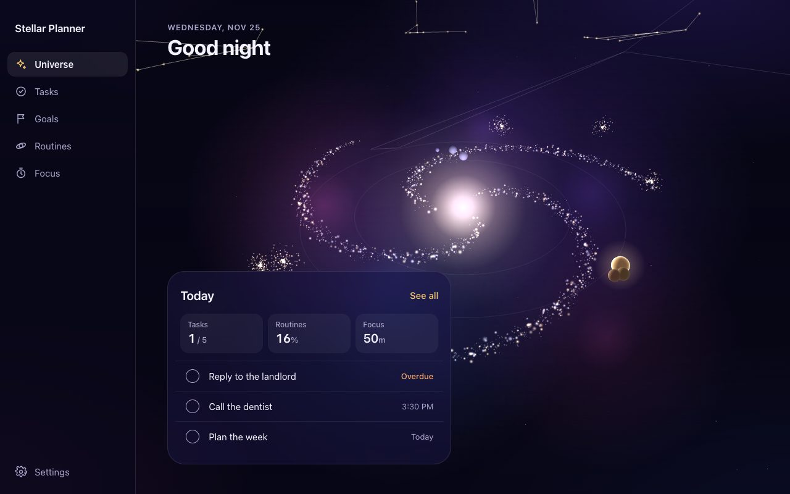
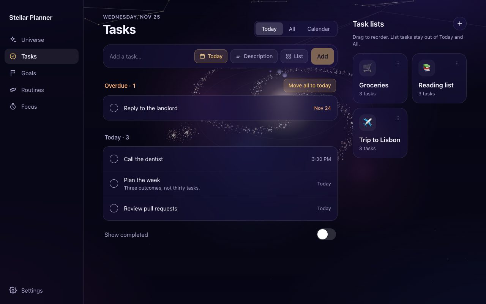
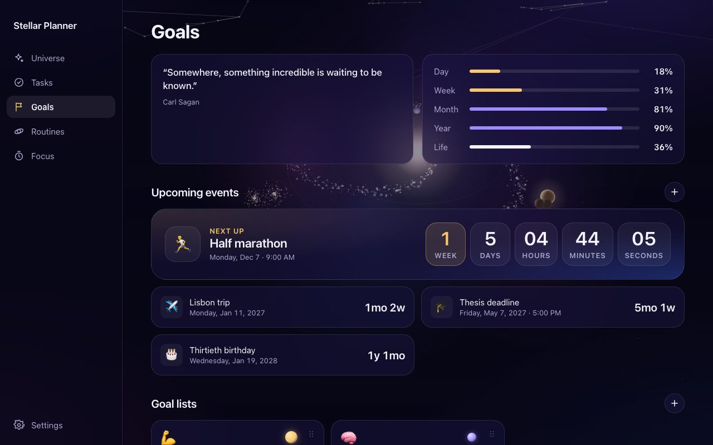
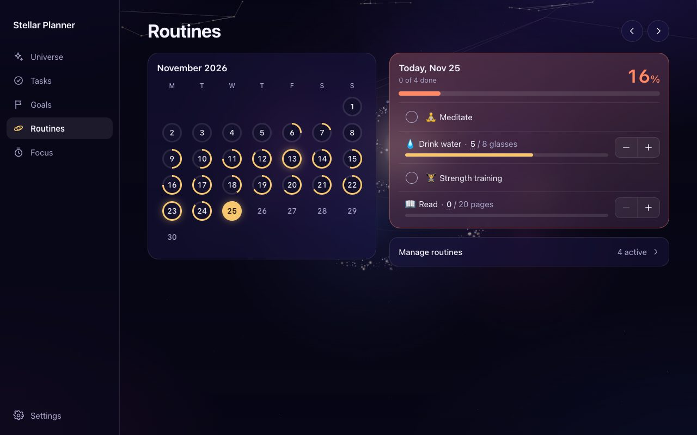
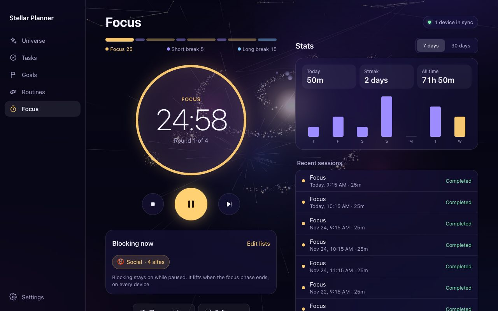
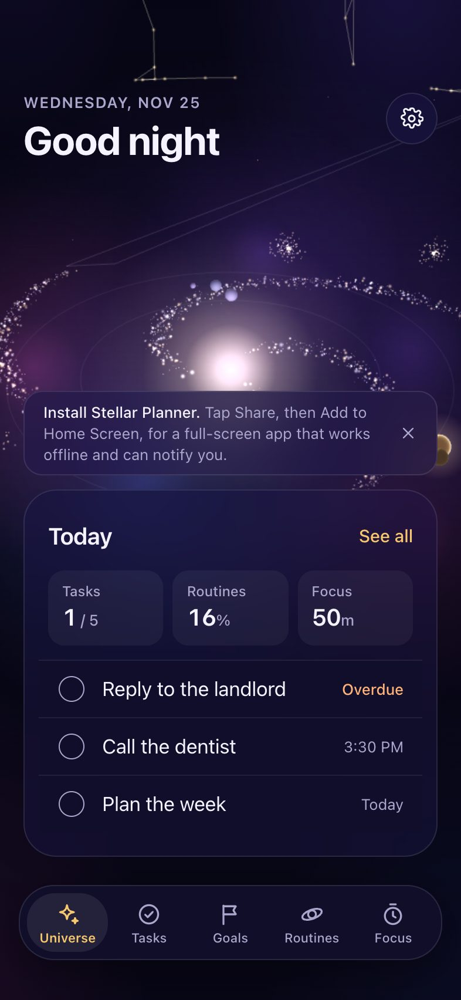
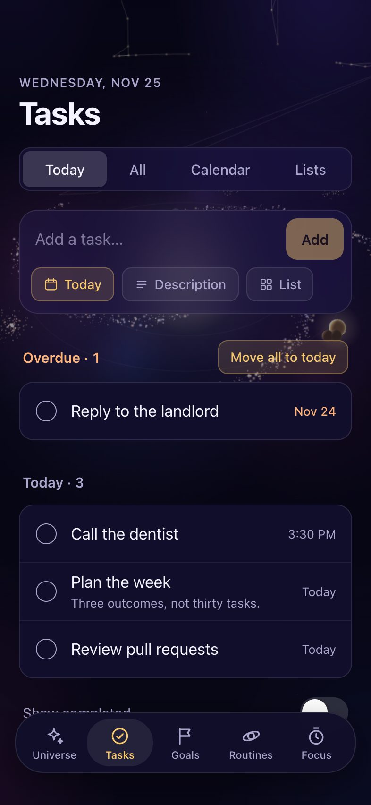
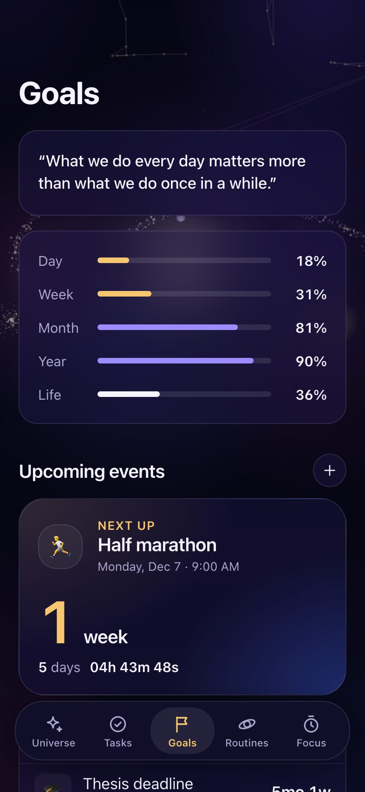
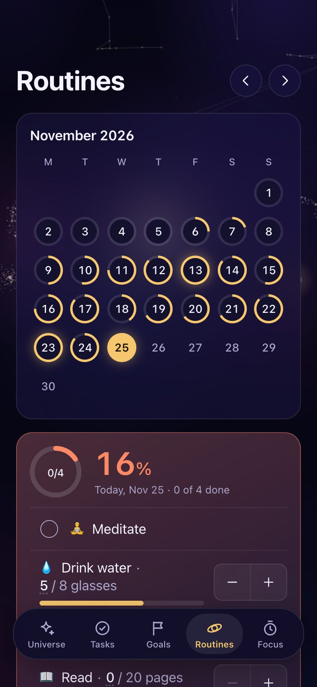
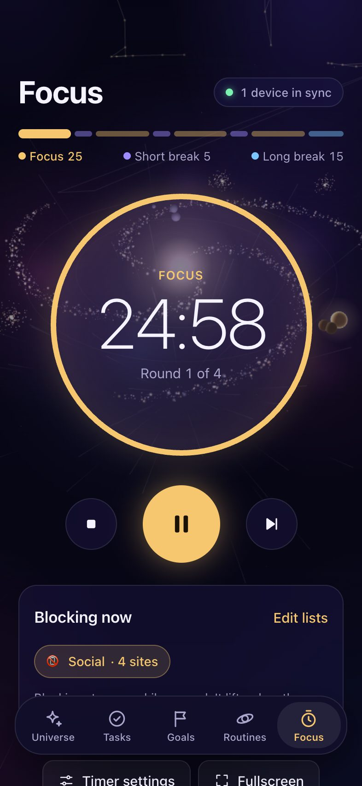

# Stellar Planner

A self-hosted personal planner where finishing things builds a universe. Tasks, long-term goals, daily routines and a focus timer, in one calm, fast app that you run yourself on top of your own Supabase.

**[Try the demo → planner.prabhas.io/demo](https://planner.prabhas.io/demo)**



## Screenshots

|                                  Tasks                                  |                               Goals                               |
| :---------------------------------------------------------------------: | :---------------------------------------------------------------: |
|        |  |
|                              **Routines**                               |                             **Focus**                             |
|  |  |

<p align="center">
  
  
  
  
  
</p>

## Features

- **Tasks.** Today, All and Calendar views, lists, quick add, swipe actions, one-tap "move overdue to today" with Undo.
- **Goals.** Todo and progress goals in lists, upcoming events with a live countdown, and progress bars for your day, week, month, year and life.
- **Routines.** Daily, weekday or every-N-days habits with a month calendar, per-day rings and streaks.
- **Focus.** A Pomodoro timer that every device shares in real time, with stats and push notifications when a phase ends.
- **Your universe.** Every completed task is a star, every goal a planet, every routine a constellation, in a 3D galaxy behind the app.
- **Built iPhone-first.** Installable to the Home Screen, aware of the Dynamic Island and home indicator, instant and usable offline.
- **One owner, one PIN.** No accounts. Your data lives in your own Postgres, protected by row-level security.

## Browser extension

**Stellar Focus** puts the same focus timer in your browser toolbar and blocks the sites you choose while a focus phase runs, with no way around it until the phase ends. Install it from the [Chrome Web Store](https://chromewebstore.google.com/detail/stellar-focus/bbmpcnffjjmnjedignkaocpifhiaoemf) or [Firefox Add-ons](https://addons.mozilla.org/en-US/firefox/addon/stellar-focus/), then connect it with your instance's address and your PIN. Source and details: [`apps/extension`](apps/extension).

## Self-hosting

You need Docker and a Supabase project: self-hosted (the official Docker setup works as is) or Supabase Cloud. The app uses its Auth, REST and Realtime services and creates tables prefixed `sp_` in the `public` schema, so it can share the project with other apps. No environment variables are required.

### Quick start

```bash
git clone https://github.com/prabhask5/stellar.git && cd stellar
docker compose up -d --build
# open http://localhost:3000
```

Mount a volume at `/data` (the compose file does). It holds the encrypted configuration; without it, every redeploy returns to the setup wizard. Anything beyond `localhost` needs HTTPS in front: installing the app, push notifications and offline use all require it.

### Deploying on a server

Stellar Planner is one long-running container. Any host that can run a Docker image with a persistent volume works: a VPS, a home server, or a platform that builds from a `Dockerfile` (Fly.io, Railway, Render, Coolify, Dokploy, CapRover and the like). It needs three things:

1. **The image**, built from this repository's `Dockerfile`. It listens on port `3000` and reports health at `/api/health`.
2. **A persistent volume mounted at `/data`.**
3. **HTTPS** on your domain, forwarding to port 3000.

On a plain server, for example with [Caddy](https://caddyserver.com) for HTTPS:

```bash
docker build -t stellar-planner .
docker run -d --name stellar-planner --restart unless-stopped \
  -p 127.0.0.1:3000:3000 -v stellar-data:/data stellar-planner
```

```
# Caddyfile
planner.example.com {
    reverse_proxy 127.0.0.1:3000
}
```

On a platform, point it at the repository, choose the Dockerfile build, add a volume at `/data`, set the internal port to `3000` and attach your domain.

**Serverless hosts such as Vercel or Netlify do not fit.** The app keeps its encrypted configuration on disk and runs a background loop that advances the focus timer and sends notifications, and neither survives in functions that start per request.

### The setup wizard

The first visit leads to `/setup`, which asks for:

- your **Supabase URL**, **anon key** and **service role key**. Use the public HTTPS URL: browsers and the extension talk to Supabase directly.
- optionally a **Postgres connection string**. With it the app runs its migrations over a direct connection and can revoke single devices. It is used by the server only, so it must be reachable from inside the container (for a Supabase on the same host, its pooler or database service on a shared Docker network, not `localhost`). Without it, migrations go through your instance's pg-meta service, or the wizard shows the SQL to paste.
- a **PIN** of 6 to 12 digits, and optionally your time zone, week start and birthdate.

The wizard creates one hidden Supabase user that your PIN unlocks. Stellar Planner needs exactly one user, so turning off sign-ups on your Supabase (`GOTRUE_DISABLE_SIGNUP=true`) is good hardening.

### Environment overrides

All optional. A value set here wins over what the wizard saved. See [`.env.example`](.env.example).

| Variable                                                         | Purpose                                                                                                   |
| ---------------------------------------------------------------- | --------------------------------------------------------------------------------------------------------- |
| `APP_SECRET`                                                     | Key that encrypts the config in `/data`. Generated if unset. Set it before setup; do not change it later. |
| `PUBLIC_APP_URL`                                                 | The app's public address, if it is not detected correctly behind your proxy.                              |
| `SUPABASE_URL`, `SUPABASE_ANON_KEY`, `SUPABASE_SERVICE_ROLE_KEY` | The Supabase connection, instead of entering it in the wizard.                                            |
| `DATABASE_URL`                                                   | The Postgres connection string.                                                                           |

### Updating, PIN recovery, backups

- **Updating:** rebuild and redeploy (`git pull && docker compose up -d --build`). Database migrations apply themselves on start.
- **Forgot your PIN:** set `RESET_PIN=true`, restart, choose a new PIN in the app, then remove the variable and restart again. Your data is untouched.
- **Backups:** your data is in the Supabase database (the `sp_` tables); back it up as you back up Postgres. Also keep the `/data` volume, and `APP_SECRET` if you set it. If `/data` is lost, run the wizard again against the same Supabase: nothing of yours is gone. **Settings → Data** exports and imports everything as one JSON file.

## REST API

Every instance serves a REST API under `/api/v1` for integrations and your own tools. It is described by the OpenAPI document at `/api/v1/openapi.json` on your instance.

## Development

Prerequisites: Node 22.18 or newer (with Corepack, which provides pnpm) and Docker.

```bash
corepack enable
pnpm install
pnpm stack:up        # local Supabase on :54321 (dev-only keys in dev/supabase/dev.env)
pnpm dev             # http://localhost:3000 → finish /setup with those keys
pnpm dev:seed        # optional: fill the instance with sample data
```

Tests:

```bash
pnpm test            # unit
pnpm test:db         # SQL behaviour and migrations (needs the stack)
pnpm build           # the e2e suites run against the production build
pnpm exec playwright install chromium webkit firefox
pnpm test:e2e        # Playwright: desktop, iPhone (Chromium and WebKit), Firefox
pnpm test:firefox    # the extension in a real Firefox
```

How the tests are organised and how to add one: [tests/README.md](tests/README.md). Architecture, data model and conventions: [CLAUDE.md](CLAUDE.md).

## Project structure

```
apps/web             Next.js app: UI, PWA, setup wizard, /api/v1
apps/extension       Stellar Focus, the Chrome and Firefox extension
packages/shared      Logic shared by both apps: dates, recurrence, timer, schemas
packages/db          SQL migrations, migration runner, table types
packages/ui-tokens   Design tokens → CSS variables and Tailwind theme
packages/universe    The 3D universe and cosmic events
dev/                 Local Supabase stacks for development and tests
tests/               Every test: unit, db, e2e, Firefox extension
```

More on each package in [packages/README.md](packages/README.md), and on the local stacks in [dev/README.md](dev/README.md).

## License

[MIT](LICENSE) © 2026 Walter Mac
