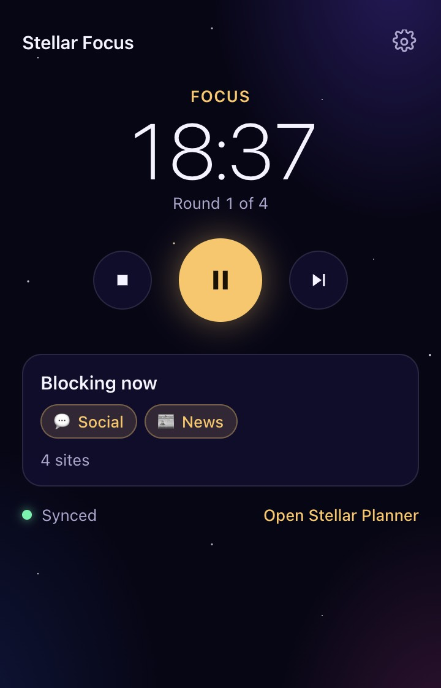
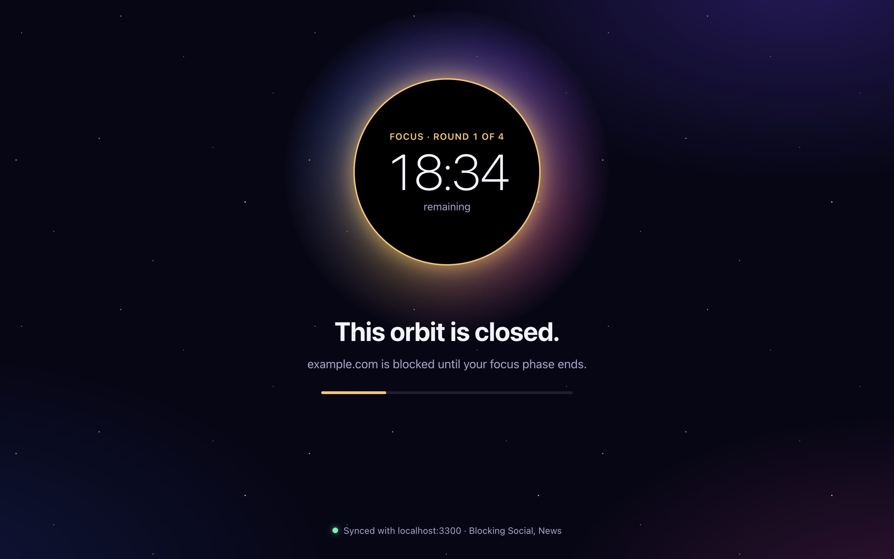

# Stellar Focus

The browser extension for [Stellar Planner](../../README.md). It puts your focus timer in the toolbar and blocks the sites on your active block lists while a focus phase runs. One codebase ([WXT](https://wxt.dev), Manifest V3) for Chrome and Chromium browsers (Edge, Brave, Arc) and for Firefox.

<p>
  
  
</p>

## Install

- **Chrome, Edge, Brave, Arc:** [Chrome Web Store](https://chromewebstore.google.com/detail/stellar-focus/bbmpcnffjjmnjedignkaocpifhiaoemf)
- **Firefox:** [Firefox Add-ons](https://addons.mozilla.org/en-US/firefox/addon/stellar-focus/)

Every Stellar Planner instance also serves the packages it was built with under **Settings → Extension**, for loading by hand.

## What it does

- **Timer in the toolbar.** The popup shows the phase and countdown with Start, Pause, Skip and End. It is the same timer as in the app: a change on any device shows everywhere within a second.
- **Badge.** Minutes remaining during focus, `B` during a break, nothing when idle.
- **Blocking.** While a focus phase is running **or paused**, navigating to a domain on an active block list (subdomains included) leads to a block page with the live countdown. Tabs already open on a blocked site are redirected when the phase starts. Breaks do not block.
- **No bypass.** The block page has no unlock button. The block lifts when the focus phase ends, from any device, and the page then offers to continue to the address you were heading for.

Block lists, and which of them are active, are managed on the app's **Focus** page.

## How it connects

1. Click the toolbar icon and enter the address where you open Stellar Planner.
2. Enter your PIN.

The extension asks the instance where its Supabase is (`GET /api/v1/instance`), signs in with the PIN (`POST /api/v1/auth/pin`), and from then on reads the timer straight from your Supabase over Realtime. It appears under **Settings → Security** in the app, where you can revoke it; **Disconnect** in the popup's settings unlinks it from the browser side.

- **Sync.** The background keeps nothing in memory. It re-syncs on browser start, every 30 seconds, when the network returns, when the popup or block page opens, and on every Realtime event.
- **Offline.** The extension remembers when the phase ends. Without a network it keeps blocking until that moment and then stops by itself. A paused phase keeps blocking until the extension can sync again.
- **Limits.** Blocking is by domain (no paths) and applies to the browser profile where the extension is installed; private windows only if you allow it there. Anyone who can remove an extension can remove this one: it is a commitment device, not parental control.

## Permissions

| Permission              | Why                                                                                                                                                                       |
| ----------------------- | ------------------------------------------------------------------------------------------------------------------------------------------------------------------------- |
| `storage`               | Remembers the instance address, the session and the last known timer state                                                                                                |
| `alarms`                | Wakes the background every 30 seconds to re-sync, and exactly when a phase ends to lift the block                                                                         |
| `declarativeNetRequest` | Installs the redirect rules for blocked sites. The extension never reads page content or browsing history                                                                 |
| `tabs`                  | Finds tabs already open on a blocked site when a focus phase starts                                                                                                       |
| Access to all sites     | A redirect rule only applies to sites the extension has access to, and any site can be put on a block list; the same access lets it reach your instance and your Supabase |

Firefox treats this host access as optional and asks for it when you connect. Firefox 140 or newer is required.

## Privacy

The extension talks only to your Stellar Planner instance and your Supabase. Nothing goes to the developer or any third party, and there are no analytics. The one kind of data it handles is authentication information: the PIN you type and the session it earns are sent to your own instance. Full policy: <https://privacy.prabhas.io/stellar-focus>

## Development

From the repository root, after `pnpm install`:

```bash
pnpm --filter @stellar/extension dev            # Chrome, reloads on change
pnpm --filter @stellar/extension dev:firefox    # Firefox
pnpm --filter @stellar/extension build          # both browsers → apps/extension/.output/{chrome-mv3,firefox-mv3}
pnpm build:extension                            # build + zip both, and copy the zips into apps/web/public/extension
```

Load the built folder by hand:

- **Chrome:** `chrome://extensions` → Developer mode → **Load unpacked** → `apps/extension/.output/chrome-mv3`.
- **Firefox:** `about:debugging#/runtime/this-firefox` → **Load Temporary Add-on…** → the Firefox zip. It stays until Firefox restarts.

Tests (see [tests/README.md](../../tests/README.md)):

```bash
pnpm test                                   # includes tests/unit/extension: rule builder, block decision, badge
pnpm test:e2e --project=desktop extension   # the built Chrome extension in a real Chromium
pnpm test:firefox                           # the packaged add-on in a real Firefox
```

The Firefox smoke test needs Firefox installed, the local stack (`pnpm stack:up`) and `pnpm build`. It starts its own app server, connects the add-on, starts a focus phase and checks the redirect, the block page countdown and the handoff when focus ends.

## Building from source (for add-on reviewers)

The sources archive submitted with the add-on is the complete source of this extension. The extension is one app in a pnpm workspace, so the archive holds this app, the three workspace packages it imports, and the lockfile. Nothing is fetched at build time except the npm packages pinned in `pnpm-lock.yaml`.

| Path in the archive                                       | What it is                                                                      |
| --------------------------------------------------------- | ------------------------------------------------------------------------------- |
| `apps/extension/`                                         | The extension: popup, block page, background script, manifest (`wxt.config.ts`) |
| `packages/shared/`                                        | Shared TypeScript: the timer state machine, date helpers, site normalisation    |
| `packages/db/`                                            | TypeScript types of the database tables (types only at build time)              |
| `packages/ui-tokens/`                                     | Design tokens as CSS variables                                                  |
| `pnpm-lock.yaml`                                          | Exact versions of every dependency                                              |
| `apps/web/package.json`, `packages/universe/package.json` | Present only so the lockfile matches the workspace; not part of the extension   |

**Requirements**

- Node.js 22 or newer (built and tested with Node 24).
- pnpm 12.21.0, the version named in `package.json` → `packageManager`. Node ships with Corepack, which downloads exactly that version; nothing else needs installing.
- Any operating system. No commercial or web-based tools are used. The bundler is WXT (open source, built on Vite), with its own minifier.

**Build**, from the root of the extracted archive:

```bash
corepack enable
corepack pnpm install --frozen-lockfile
corepack pnpm --filter @stellar/extension exec wxt build -b firefox --mv3
```

The built add-on is in `apps/extension/.output/firefox-mv3/`. Its files are identical to the contents of the submitted package. To produce the zip itself:

```bash
corepack pnpm --filter @stellar/extension exec wxt zip -b firefox --mv3
# → apps/extension/.output/stellar-focus-<version>-firefox.zip
```

**Notes**

- There is no obfuscation. The output is bundled and minified by Vite; source maps are not shipped.
- The extension runs no remote code. Every script it executes is in the package.
- `@supabase/supabase-js` is the one sizeable third-party library in the bundle; it is the client for the user's own database and realtime connection.
